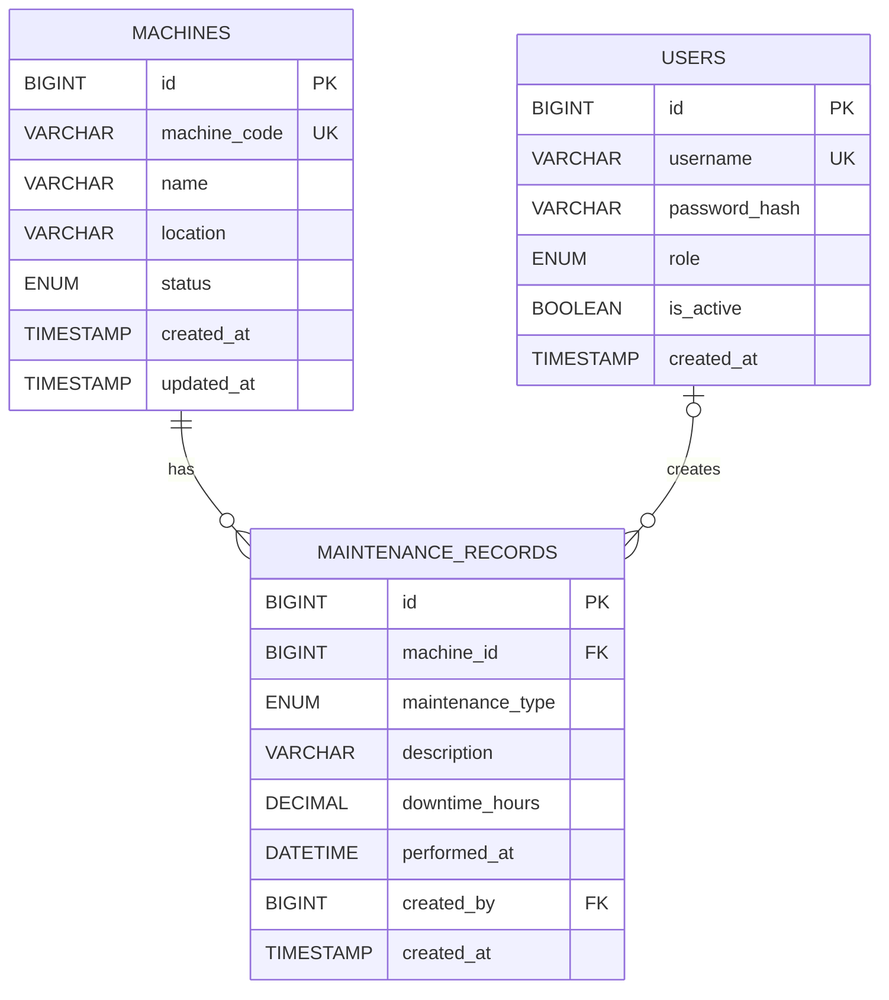

# Entity Relationship Diagram

## Industrial IoT Predictive Maintenance & Sensor Alert Engine

### 1. Overview

The project uses a hybrid database architecture combining MySQL and MongoDB.

MySQL manages structured relational information, including:

- User accounts and roles
- Machine information
- Maintenance history
- Relationships between machines, users, and maintenance records

MongoDB manages sensor readings, alerts, and other flexible operational data.

This ER diagram represents the relational MySQL component.

## 2. Entity Relationship Diagram

## 3. Entity Descriptions

### USERS

Stores application user information.

Attributes:

- id: Unique user identifier
- username: Unique login username
- password_hash: Securely stored password hash
- role: Admin or technician
- is_active: Account activation status
- created_at: Account creation timestamp

Primary Key: id

Unique Key: username

### MACHINES

Stores industrial machine details.

Attributes:

- id: Unique machine identifier
- machine_code: Unique machine code
- name: Machine name
- location: Installation location
- status: Current operational status
- created_at: Creation timestamp
- updated_at: Last modification timestamp

Primary Key: id

Unique Key: machine_code

### MAINTENANCE_RECORDS

Stores maintenance activities performed on machines.

Attributes:

- id: Unique maintenance record identifier
- machine_id: Machine associated with maintenance
- maintenance_type: Preventive, corrective, or inspection
- description: Maintenance activity details
- downtime_hours: Duration of downtime
- performed_at: Date and time of maintenance
- created_by: User who created the record
- created_at: Record creation timestamp

Primary Key: id

Foreign Keys:

- machine_id references machines(id)
- created_by references users(id)

## 4. Relationships

### Machine to Maintenance Records

Relationship: One-to-Many

One machine can have multiple maintenance records.

Each maintenance record belongs to exactly one machine.

Foreign Key:

maintenance_records.machine_id -> machines.id

Deletion Rule:

ON DELETE RESTRICT

A machine cannot be deleted while maintenance records reference it.

### User to Maintenance Records

Relationship: One-to-Many

One user can create multiple maintenance records.

A maintenance record may exist without an associated user.

Foreign Key:

maintenance_records.created_by -> users.id

Deletion Rule:

ON DELETE SET NULL

Deleting a user preserves maintenance history while setting created_by to NULL.

## 5. Database Design Considerations

The relational schema provides:

1. Entity integrity through primary keys.
2. Referential integrity through foreign keys.
3. Domain integrity through ENUM and CHECK constraints.
4. Uniqueness through UNIQUE constraints.
5. Query optimization through indexes.
6. Historical maintenance tracking.
7. Controlled deletion behavior.

## 6. Hybrid Database Architecture

The complete project uses two databases.

MySQL:

- users
- machines
- maintenance_records

MongoDB:

- Sensor-related collections
- Alert-related collections

MongoDB collection definitions and their relationships are documented separately.

The MySQL ER diagram does not represent MongoDB collections because they are not relational tables with SQL foreign-key constraints.