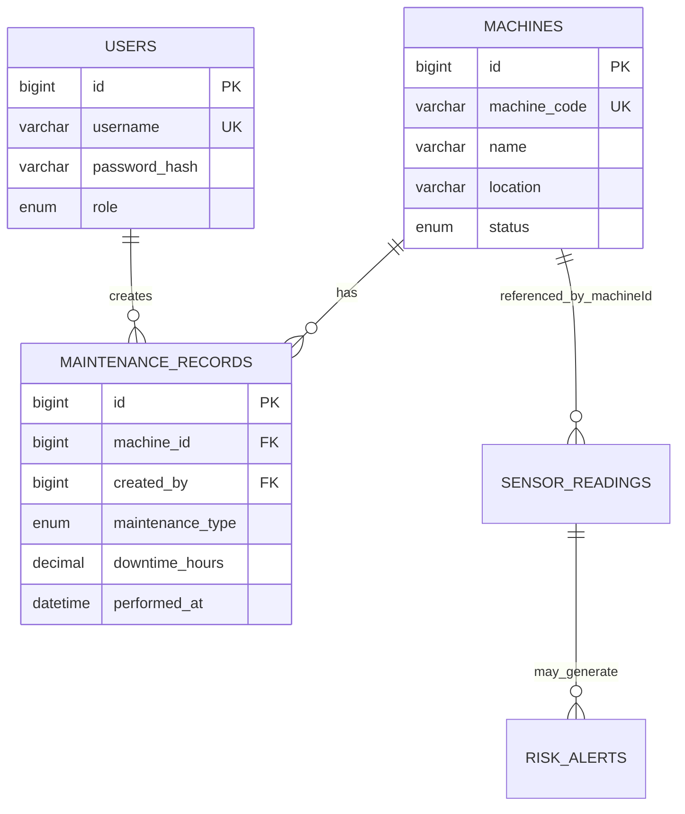

# Industrial Predictive Maintenance — DBMS Level 3 Project

## 1. Objectives

- Centralize machine, user, maintenance, sensor-reading and risk-alert data.
- Monitor temperature, vibration and pressure readings.
- Identify abnormal readings using transparent threshold rules and create alerts.
- Use historical readings and maintenance records to support maintenance decisions.
- Provide a dashboard for machine status, sensor readings, risk alerts and maintenance.

## 2. Functional requirements

1. Admin and technician login using a hashed password and signed HTTP-only session cookie.
2. Admin can register and delete machines; machine code must be unique.
3. Authenticated users can record and review sensor readings.
4. Each sensor reading receives a documented LOW/MEDIUM/HIGH rule-based risk result.
5. Non-low readings are stored as risk alerts.
6. Authenticated users can create and review maintenance records.
7. Dashboard shows machine counts, running count, historical high-risk alert count, maintenance count and latest readings/alerts.
8. API validates request values; SQL constraints and foreign keys enforce data integrity.

## 3. Database choice and justification

- **MySQL (mandatory SQL paradigm):** Normalized entities with relationships and constraints: users, machines and maintenance_records. Supports transactions, constraints, indexes, views, a trigger and a stored procedure.
- **MongoDB (NoSQL paradigm):** Flexible sensor readings and risk-alert documents with timestamped measurements and computed risk metadata. Compound indexes support machine/time and risk/time queries.
- Vector search is not implemented because the core data are numeric time-series readings and relational maintenance records, not text-heavy semantic data. Vector databases are optional/recommended, not mandatory in the supplied requirements.

## 4. ER diagram



MongoDB collections refer to `machines.id` by numeric `machineId`; cross-database references are application-enforced, not database-enforced foreign keys.

## 5. Relational schema

- `users(id PK, username UNIQUE, password_hash, role, is_active, created_at)`
- `machines(id PK, machine_code UNIQUE, name, location, status, created_at, updated_at)`
- `maintenance_records(id PK, machine_id FK → machines.id, created_by FK → users.id, maintenance_type, description, downtime_hours, performed_at, created_at)`
- `machine_maintenance_summary` is a view over machines and maintenance records.

## 6. Data dictionary

### users

`id`: Surrogate primary key; `username`: Unique login; `password_hash`: bcrypt hash, never plaintext; `role`: admin/technician; `is_active`: Login enablement.

### machines

`machine_code`: Unique human-readable identifier; `name`: Machine label; `location`: Operating location; `status`: RUNNING/IDLE/MAINTENANCE/OFFLINE.

### maintenance_records

`machine_id`: Machine FK; `maintenance_type`: PREVENTIVE/CORRECTIVE/INSPECTION; `description`: Work performed; `downtime_hours`: Non-negative decimal; `performed_at`: Event time; `created_by`: User FK.

### MongoDB `sensor_readings`

- `machineId`: Numeric SQL machine ID.
- `temperature`: Temperature in Celsius.
- `vibration`: Vibration in mm/s.
- `pressure`: Pressure in bar.
- `recordedAt`: Timestamp.
- `risk`: LOW/MEDIUM/HIGH.
- `score`: Risk score from 0–100.
- `reasons`: Array of strings describing triggered conditions.

### MongoDB `risk_alerts`

Contains the triggering reading values, risk score/reasons, `readingId` reference, `machineId`, `recordedAt`, and `createdAt`.

## 7. Risk-screening method

This is a transparent rule-based screening baseline, **not a trained machine-learning model and not validated for safety-critical use**:

- Temperature >= 85 °C adds a reason.
- Vibration >= 7 mm/s adds a reason.
- Pressure below 2 bar or above 10 bar adds a reason.
- Score = min(100, 40 × number of reasons + 20 if temperature >= 95 + 20 if vibration >= 10).
- HIGH if score >= 60; MEDIUM if score >= 30; otherwise LOW.

Thresholds are example values for the project demo and must be tuned to manufacturer limits and real operating data before deployment. The system does not claim statistically calibrated failure probability.

## 8. SQL concepts and important queries

The implementation demonstrates:

- DDL: CREATE DATABASE/TABLE/VIEW/INDEX, plus commented ALTER and DROP examples.
- Keys and constraints: primary, unique, foreign, CHECK, ENUM.
- Indexing: machine status, maintenance type, machine/date.
- View: `machine_maintenance_summary`.
- Trigger: validates maintenance description and downtime.
- Stored procedure: `get_machine_maintenance`.
- Transaction pattern: use a transaction for related multi-table writes; current maintenance insert is one atomic SQL statement. Add `START TRANSACTION; ... COMMIT;` around future multi-statement SQL operations.
- DML through application: INSERT machines, readings and maintenance; DELETE machines; SELECT dashboards and lists.
- JOIN/GROUP BY/aggregate: view uses LEFT JOIN, COUNT, SUM, MAX, GROUP BY.

### Additional query examples

```sql
-- JOIN + aggregate
SELECT m.machine_code, m.name, COUNT(r.id) AS work_orders,
       COALESCE(SUM(r.downtime_hours),0) AS downtime_hours
FROM machines m LEFT JOIN maintenance_records r ON r.machine_id=m.id
GROUP BY m.id,m.machine_code,m.name
ORDER BY downtime_hours DESC;

-- HAVING
SELECT machine_id, COUNT(*) AS events
FROM maintenance_records GROUP BY machine_id HAVING COUNT(*) > 1;

-- Subquery: machines with any corrective maintenance
SELECT machine_code,name FROM machines
WHERE id IN (SELECT machine_id FROM maintenance_records WHERE maintenance_type='CORRECTIVE');

-- View
SELECT * FROM machine_maintenance_summary ORDER BY total_downtime_hours DESC;

-- Stored procedure
CALL get_machine_maintenance(1);

-- Transaction example for future multi-step maintenance workflow
START TRANSACTION;
UPDATE machines SET status='MAINTENANCE' WHERE id=1;
INSERT INTO maintenance_records(machine_id,maintenance_type,description,downtime_hours)
VALUES(1,'INSPECTION','Transactional demonstration',0.25);
COMMIT;
```

## 9. MongoDB model, CRUD operations, indexes and retrieval

The project uses MongoDB as its NoSQL database for storing sensor readings and risk alerts. These records contain timestamped numeric measurements and derived risk information.

### 9.1 Collections

**`sensor_readings`**

Stores:

- `machineId`: Numeric ID referencing the machine in MySQL.
- `temperature`: Temperature measurement in °C.
- `vibration`: Vibration measurement in mm/s.
- `pressure`: Pressure measurement in bar.
- `recordedAt`: Date and time of the reading.
- `risk`: Calculated risk category (LOW, MEDIUM or HIGH).
- `score`: Rule-based risk score from 0 to 100.
- `reasons`: Array containing the threshold conditions that were triggered.

**`risk_alerts`**

Stores abnormal reading information, including:

- `readingId`: Reference to the associated sensor reading.
- `machineId`: Numeric MySQL machine ID.
- Sensor measurement values.
- `risk`: Risk category.
- `score`: Calculated risk score.
- `reasons`: Triggered threshold conditions.
- `recordedAt`: Sensor reading timestamp.
- `createdAt`: Alert creation timestamp.

The relationship between MongoDB documents and MySQL machines is maintained by the application. It is not a cross-database foreign key.

### 9.2 CRUD operations

The application provides sensor-reading operations through Next.js API routes:

- **Create:** Accepts sensor readings, validates the input, verifies the referenced machine and calculates the risk result.
- **Read:** Retrieves sensor readings for dashboard display and historical review.
- **Update:** Allows an existing reading to be updated, recalculates its risk result and synchronizes the associated risk alert.
- **Delete:** Allows an authorized administrator to delete a reading and its associated risk alert.

Non-low readings generate corresponding risk-alert documents. Low-risk readings do not generate alerts.

### 9.3 MongoDB indexes

The following compound indexes are initialized through `mongodb/init.js`:

| Collection | Index | Purpose |
|---|---|---|
| `sensor_readings` | `{machineId: 1, recordedAt: -1}` | Retrieve recent readings for a particular machine |
| `sensor_readings` | `{risk: 1, recordedAt: -1}` | Filter readings by risk and time |
| `risk_alerts` | `{risk: 1, recordedAt: -1}` | Retrieve alerts by risk and time |
| `risk_alerts` | `{machineId: 1, recordedAt: -1}` | Retrieve alerts for a particular machine |

The indexes support common dashboard queries and historical sensor-data retrieval.

### 9.4 Data retention

Historical sensor readings are retained for analysis. No automatic TTL expiration is enabled for the collections.

### 9.5 Retrieval

The application retrieves sensor readings and risk alerts for dashboard display and historical review. Compound indexes support filtering by machine, risk category and timestamp.

### 9.6 Vector search

Vector search is not implemented because the project's core data consists of numeric time-series measurements and relational maintenance records. Traditional document queries and compound indexes are suitable for the current project requirements.

## 10. Security implementation

The application implements authentication and role-based authorization to protect its API routes and database operations.

### 10.1 Password security

- User passwords are stored as bcrypt hashes in the MySQL `users` table.
- During login, `bcrypt.compare()` verifies the entered password against the stored hash.
- Plaintext passwords are not stored in the database.

### 10.2 JWT authentication

- Successful login generates a JSON Web Token (JWT).
- The token uses the HS256 signing algorithm.
- The JWT contains the user's ID, username and role.
- Tokens expire after 8 hours.
- The signing secret is read from the `JWT_SECRET` environment variable.
- The application requires the secret to contain at least 32 characters.

### 10.3 Secure session cookie

The JWT is stored in a cookie named `ipm_session` with the following settings:

| Cookie property | Configuration |
|---|---|
| HTTP-only | Enabled |
| SameSite | Lax |
| Secure | Enabled in production |
| Path | `/` |
| Maximum age | 8 hours |

The HTTP-only setting prevents client-side JavaScript from directly accessing the session cookie.

### 10.4 Role-based access control (RBAC)

The application defines two roles:

- **Admin:** Can perform administrative machine operations, including updating and deleting machines.
- **Technician:** Can access permitted authenticated application functionality but cannot update or delete machines.

Role checks are performed on the server through API route handlers. Unauthorized requests return HTTP 401, while requests with insufficient permissions return HTTP 403.

### 10.5 API and database security

- API inputs are validated using Zod schemas.
- SQL queries use parameterized values to reduce SQL injection risk.
- Database connection details and JWT secrets are read from environment variables.
- MongoDB connections use the configured `MONGODB_URI`.
- The application checks that referenced machines exist before accepting sensor readings.

### 10.6 Security limitations

- Database-level MongoDB user roles and collection permissions are not configured by the application code documented here.
- SameSite cookies provide some cross-site request protection, but this implementation does not demonstrate a separate CSRF token mechanism.
- The prototype should use strong environment secrets, HTTPS and appropriately restricted database credentials before deployment.

## 11. Architecture

Browser (Next.js React UI) → Next.js Route Handlers (`/api/*`) → MySQL for users/machines/maintenance and MongoDB for readings/alerts.

Credentials are read from environment variables. Passwords are bcrypt-hashed; session token is a signed HTTP-only cookie.

## 12. Testing checklist

1. Valid login succeeds; invalid password returns 401.
2. Unauthenticated API call returns 401.
3. Technician cannot create/delete a machine (403); admin can.
4. Duplicate machine code is rejected.
5. Invalid machine/readings/maintenance values are rejected by Zod validation and/or SQL constraints.
6. Reading referencing nonexistent machine is rejected.
7. Reading under thresholds is saved LOW and does not create an alert.
8. Abnormal reading is saved and creates an alert.
9. Maintenance row with nonexistent machine is rejected.
10. Machine delete with linked maintenance is restricted by FK.
11. Dashboard counters and recent records load after seed and test actions.
12. SQL view, trigger and stored procedure execute successfully.

## 13. Screenshots

Capture screenshots after running the application: login, overview dashboard, machine register, sensor readings, maintenance log and alerts tab.

Screenshots are intentionally not fabricated; add real screenshots from your local run here.

## 14. Team contributions

Two-person team requirement from the course: fill in actual names and actual work completed; do not claim work that was not performed.

- Member 1: Database schema, constraints, indexes, SQL routines and test execution: ______________________
- Member 2: Next.js UI/API, authentication, MongoDB integration and documentation: ______________________

Both members should contribute to database and application development and make individual Git commits.

## 15. Conclusion

The prototype integrates a relational database, a NoSQL time-series document store and a web dashboard. It demonstrates data integrity, role-aware access, CRUD operations, aggregation, indexes, views, a trigger and a stored procedure.

The risk score is a threshold-based demonstration and should not be represented as a trained predictive model without a separately trained and evaluated model.

### MongoDB Database-Level Security

The project uses MongoDB Community Server locally for development.
The current local MongoDB connection uses localhost without
username/password authentication.

Application-level security is implemented through JWT authentication,
role-based access control, and protected API routes.

Database-level MongoDB authentication and custom database user roles
are not configured in the current development setup.

For production deployment, MongoDB authentication should be enabled,
a dedicated database user with least-privilege permissions should
be created, and credentials should be stored securely in environment
variables.