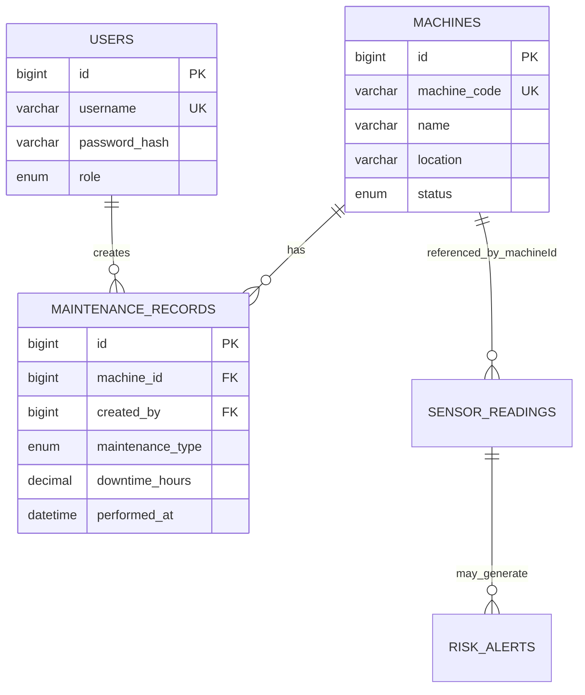

# Industrial Predictive Maintenance — DBMS Level 3 Project

## 1. Objectives
- Centralize machine, user, maintenance, sensor-reading and risk-alert data.
- Monitor temperature, vibration and pressure readings.
- Identify abnormal readings using transparent threshold rules and create alerts.
- Use historical readings and maintenance records to support maintenance decisions.
- Provide a dashboard for machine status, sensor readings, risk alerts and maintenance.

## 2. Functional requirements
1. Admin and technician login using a hashed password and signed HTTP-only session cookie.
2. Admin can register and delete machines; machine code must be unique.
3. Authenticated users can record and review sensor readings.
4. Each sensor reading receives a documented LOW/MEDIUM/HIGH rule-based risk result.
5. Non-low readings are stored as risk alerts.
6. Authenticated users can create and review maintenance records.
7. Dashboard shows machine counts, running count, historical high-risk alert count, maintenance count and latest readings/alerts.
8. API validates request values; SQL constraints and foreign keys enforce data integrity.

## 3. Database choice and justification
- **MySQL (mandatory SQL paradigm):** normalized entities with relationships and constraints: users, machines and maintenance_records. Supports transactions, constraints, indexes, views, a trigger and a stored procedure.
- **MongoDB (NoSQL paradigm):** flexible sensor readings and risk-alert documents with timestamped measurements and computed risk metadata. Compound indexes support machine/time and risk/time queries.
- Vector search is not implemented because the core data are numeric time-series readings and relational maintenance records, not text-heavy semantic data. Vector databases are optional/recommended, not mandatory in the supplied requirements.

## 4. ER diagram

MongoDB collections refer to `machines.id` by numeric `machineId`; cross-database references are application-enforced, not database-enforced foreign keys.

## 5. Relational schema
- `users(id PK, username UNIQUE, password_hash, role, is_active, created_at)`
- `machines(id PK, machine_code UNIQUE, name, location, status, created_at, updated_at)`
- `maintenance_records(id PK, machine_id FK → machines.id, created_by FK → users.id, maintenance_type, description, downtime_hours, performed_at, created_at)`
- `machine_maintenance_summary` is a view over machines and maintenance records.

## 6. Data dictionary
### users
`id`: surrogate primary key; `username`: unique login; `password_hash`: bcrypt hash, never plaintext; `role`: admin/technician; `is_active`: login enablement.

### machines
`machine_code`: unique human-readable identifier; `name`: machine label; `location`: operating location; `status`: RUNNING/IDLE/MAINTENANCE/OFFLINE.

### maintenance_records
`machine_id`: machine FK; `maintenance_type`: PREVENTIVE/CORRECTIVE/INSPECTION; `description`: work performed; `downtime_hours`: non-negative decimal; `performed_at`: event time; `created_by`: user FK.

### MongoDB `sensor_readings`
`machineId` numeric SQL machine ID; `temperature` Celsius; `vibration` mm/s; `pressure` bar; `recordedAt` timestamp; `risk` LOW/MEDIUM/HIGH; `score` 0–100; `reasons` string array.

### MongoDB `risk_alerts`
Contains the triggering reading values, risk score/reasons, `readingId` reference, `machineId`, `recordedAt`, and `createdAt`.

## 7. Risk-screening method
This is a transparent rule-based screening baseline, **not a trained machine-learning model and not validated for safety-critical use**:
- Temperature >= 85 °C adds a reason.
- Vibration >= 7 mm/s adds a reason.
- Pressure below 2 bar or above 10 bar adds a reason.
- Score = min(100, 40 × number of reasons + 20 if temperature >= 95 + 20 if vibration >= 10).
- HIGH if score >= 60; MEDIUM if score >= 30; otherwise LOW.
Thresholds are example values for the project demo and must be tuned to manufacturer limits and real operating data before deployment. The system does not claim statistically calibrated failure probability.

## 8. SQL concepts and important queries
The implementation demonstrates:
- DDL: CREATE DATABASE/TABLE/VIEW/INDEX, plus commented ALTER and DROP examples.
- Keys and constraints: primary, unique, foreign, CHECK, ENUM.
- Indexing: machine status, maintenance type, machine/date.
- View: `machine_maintenance_summary`.
- Trigger: validates maintenance description and downtime.
- Stored procedure: `get_machine_maintenance`.
- Transaction pattern: use a transaction for related multi-table writes; current maintenance insert is one atomic SQL statement. Add `START TRANSACTION; ... COMMIT;` around future multi-statement SQL operations.
- DML through application: INSERT machines, readings and maintenance; DELETE machines; SELECT dashboards and lists.
- JOIN/GROUP BY/aggregate: view uses LEFT JOIN, COUNT, SUM, MAX, GROUP BY.

Additional query examples:
```sql
-- JOIN + aggregate
SELECT m.machine_code, m.name, COUNT(r.id) AS work_orders,
       COALESCE(SUM(r.downtime_hours),0) AS downtime_hours
FROM machines m LEFT JOIN maintenance_records r ON r.machine_id=m.id
GROUP BY m.id,m.machine_code,m.name
ORDER BY downtime_hours DESC;

-- HAVING
SELECT machine_id, COUNT(*) AS events
FROM maintenance_records GROUP BY machine_id HAVING COUNT(*) > 1;

-- Subquery: machines with any corrective maintenance
SELECT machine_code,name FROM machines
WHERE id IN (SELECT machine_id FROM maintenance_records WHERE maintenance_type='CORRECTIVE');

-- View
SELECT * FROM machine_maintenance_summary ORDER BY total_downtime_hours DESC;

-- Stored procedure
CALL get_machine_maintenance(1);

-- Transaction example for future multi-step maintenance workflow
START TRANSACTION;
UPDATE machines SET status='MAINTENANCE' WHERE id=1;
INSERT INTO maintenance_records(machine_id,maintenance_type,description,downtime_hours)
VALUES(1,'INSPECTION','Transactional demonstration',0.25);
COMMIT;
```

## 9. MongoDB model, indexes and retrieval
- Collections: `sensor_readings`, `risk_alerts`.
- Documents store numeric sensor measurements, SQL machine ID, timestamps and derived risk metadata.
- Indexes: `{machineId:1, recordedAt:-1}`, `{risk:1, recordedAt:-1}` on both collections as applicable.
- Retrieval: most recent readings sorted descending by `recordedAt`; alert dashboard filters/sorts by risk and timestamp.
- No embeddings or similarity metric are used because vector search is not required for this numeric sensor dataset.

## 10. Architecture
Browser (Next.js React UI) → Next.js Route Handlers (`/api/*`) → MySQL for users/machines/maintenance and MongoDB for readings/alerts. Credentials are read from environment variables. Passwords are bcrypt-hashed; session token is a signed HTTP-only cookie.

## 11. Testing checklist
1. Valid login succeeds; invalid password returns 401.
2. Unauthenticated API call returns 401.
3. Technician cannot create/delete a machine (403); admin can.
4. Duplicate machine code is rejected.
5. Invalid machine/readings/maintenance values are rejected by Zod validation and/or SQL constraints.
6. Reading referencing nonexistent machine is rejected.
7. Reading under thresholds is saved LOW and does not create an alert.
8. Abnormal reading is saved and creates an alert.
9. Maintenance row with nonexistent machine is rejected.
10. Machine delete with linked maintenance is restricted by FK.
11. Dashboard counters and recent records load after seed and test actions.
12. SQL view, trigger and stored procedure execute successfully.

## 12. Screenshots
Capture screenshots after running the application: login, overview dashboard, machine register, sensor readings, maintenance log and alerts tab. Screenshots are intentionally not fabricated; add real screenshots from your local run here.

## 13. Team contributions
Two-person team requirement from the course: fill in actual names and actual work completed; do not claim work that was not performed.
- Member 1: database schema, constraints, indexes, SQL routines and test execution: __________________
- Member 2: Next.js UI/API, authentication, MongoDB integration and documentation: __________________
Both members should contribute to database and application development and make individual Git commits.

## 14. Conclusion
The prototype integrates a relational database, a NoSQL time-series document store and a web dashboard. It demonstrates data integrity, role-aware access, CRUD operations, aggregation, indexes, views, a trigger and a stored procedure. The risk score is a threshold-based demonstration and should not be represented as a trained predictive model without a separately trained and evaluated model.
